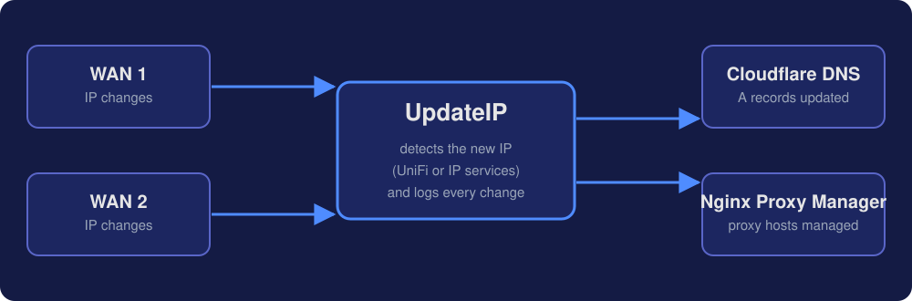
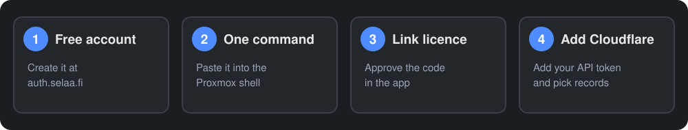
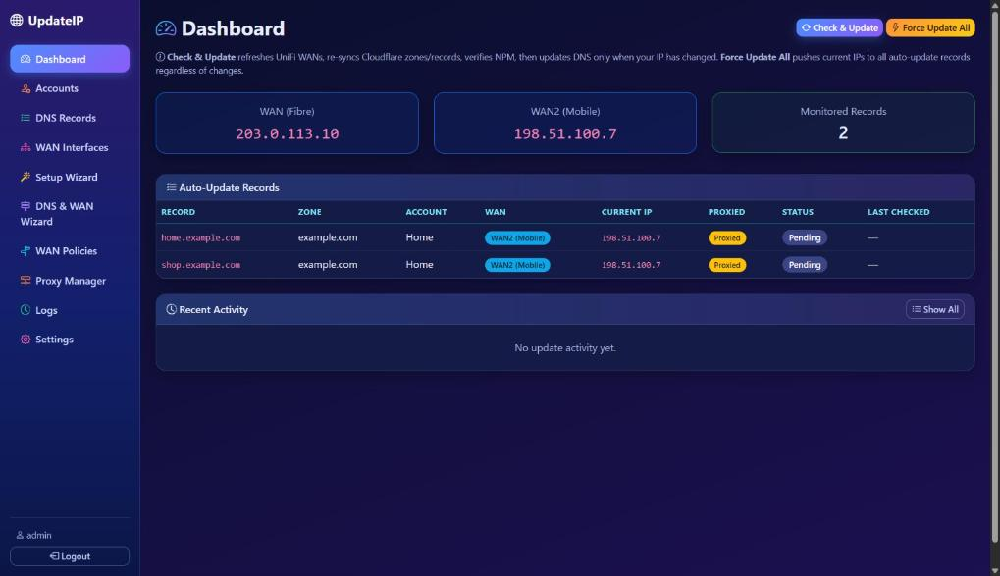
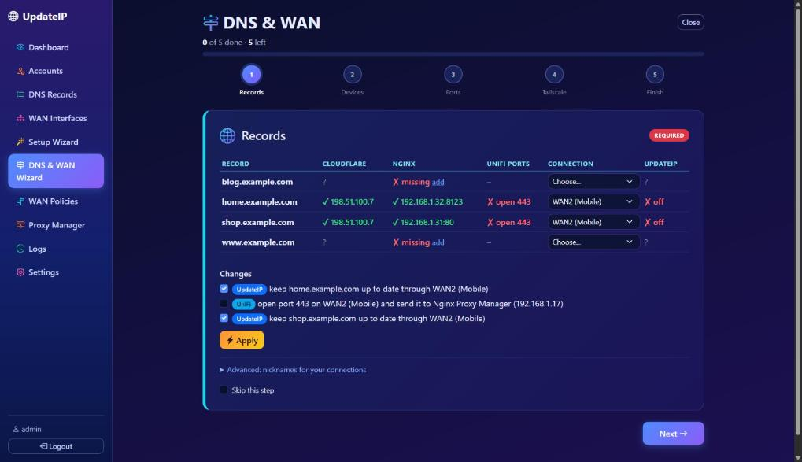
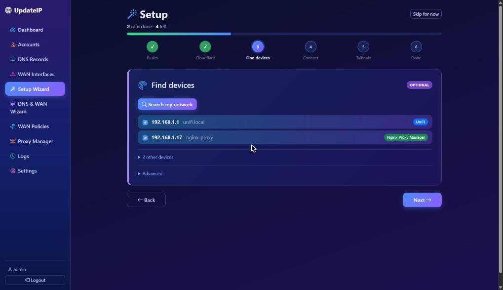

<p align="center">
  
</p>

<p align="center">
  
  
  
  
  
  
</p>

**UpdateIP** is a self-hosted web app that watches your public IP address and updates your **Cloudflare DNS** records automatically when it changes. It supports **multi-WAN** setups, detects WANs from a **UniFi** gateway, manages **Nginx Proxy Manager** hosts, and installs on **Proxmox** with a single command.

> **Licence notice:** a free BluexDEV account ([auth.selaa.fi](https://auth.selaa.fi)) and a licence key are required, and **the app does not work without a valid licence**. The licence is **free for now, but it may become paid at any time, without prior notice.** See [LICENSE](LICENSE).

## How it works

<p align="center"></p>

1. UpdateIP checks each WAN on a schedule, using your UniFi gateway or external IP services.
2. When an IP has changed, it updates the Cloudflare A records you selected for that WAN.
3. Every change and every update result is written to the history log.

A DNS record assigned to a specific WAN is never updated with another WAN's IP: if that WAN's IP is unavailable, the update is skipped and logged.

## Install

<p align="center"></p>

### What you need

| Requirement | Details |
|---|---|
| Proxmox VE host | The installer creates a Debian 13 LXC container (1 core, 512 MB RAM, 4 GB disk by default) |
| Internet access | From the Proxmox host and the container |
| BluexDEV account | Free, at [auth.selaa.fi](https://auth.selaa.fi). A licence key is created for you when you link the account |
| Cloudflare API token | [Zone:DNS:Edit + Zone:Zone:Read](https://dash.cloudflare.com/profile/api-tokens) |
| *Optional* | A UniFi gateway (UDM, UDM-Pro, UDM-SE, UCG) and a Nginx Proxy Manager instance |

### One command

1. Create your free account at [auth.selaa.fi](https://auth.selaa.fi). A step-by-step guide is at [auth.selaa.fi/start/updateip](https://auth.selaa.fi/start/updateip).
2. Open the **Proxmox shell** as root and run:

```bash
bash -c "$(curl -fsSL https://raw.githubusercontent.com/JuhaFIN1/UpdateIP_Cloudflare/main/install/updateip-lxc.sh)"
```

3. Choose **Default** (1 core, 512 MB, 4 GB, DHCP) or **Advanced** (container ID, resources, storage, bridge, **static IP**). A static IP or a DHCP reservation is recommended.
4. When it finishes, open the address it prints (`http://<container-ip>` or `http://updateip.local`).
5. Sign in with **`admin` / `admin`**. The app asks you to choose your own password straight away (at least 8 characters); nothing else works until you have.

6. The app opens the **Licence** page. Click **Link BluexDEV account**, open the link, sign in and approve the code. The app unlocks when the licence is valid.
7. Add your Cloudflare account (see [Usage](#usage)).

The installer creates a clean container with no data in it, installs the app to `/opt/updateip`, and logs to `/var/log/updateip-install.log` inside the container. It never creates a second container when one named `updateip` already exists.

**Updating:** open **Settings** in the app and use the update button. Your data is kept.

<details>
<summary><b>Manual install (advanced)</b></summary>

Debian or Ubuntu with Python 3.10+ (tested on Debian 13), as root:

```bash
git clone https://github.com/JuhaFIN1/UpdateIP_Cloudflare.git
cd UpdateIP_Cloudflare
bash setup.sh
```

`setup.sh` installs avahi and Nginx, creates a Python virtual environment, initializes the database, sets up a systemd service (port 5000) and an Nginx reverse proxy (port 80 to 5000). The login is `admin` / `admin`; the app forces you to choose your own password at the first sign-in. Licence linking works as described above.
</details>

## Features

| | |
|---|---|
| **Multi-WAN** | Manage several WAN interfaces and assign each DNS record to a specific WAN |
| **UniFi integration** | Detect WAN IPs and ISP info from a UniFi gateway |
| **Cloudflare DNS** | Auto-update selected A records; create, edit and delete records of all types (A, AAAA, CNAME, MX, TXT, SRV, NS, CAA) |
| **Multiple accounts** | Several Cloudflare accounts and zones, records grouped by domain |
| **Nginx Proxy Manager** | Full create, edit and delete of proxy hosts on a remote NPM instance |
| **Scheduler** | Configurable sync intervals for UniFi, Cloudflare and NPM |
| **Check & Update / Force** | Update only when the IP changed, or push current IPs to every auto-update record |
| **History** | Log of IP changes and DNS update results |
| **mDNS** | Reach the app at `updateip.local` (configurable hostname via Avahi) |
| **Backup & Restore** | Download a full JSON backup; restore selectively with a comparison preview |
| **Updates** | Daily update check with one-click install and live progress; Debian apt update from Settings |
| **UI** | Dark Bootstrap 5 interface, mobile friendly, timezone setting |
| **Security** | bcrypt passwords, session login, forced password change at the first sign-in |

## Screenshots

Example data. Nothing here is from a real installation.

<p align="center"></p>

<p align="center"></p>

<p align="center"></p>

## Usage

<details open>
<summary><b>1. Add a Cloudflare account</b></summary>

Go to **Accounts**, then **Add Account**, and enter a name and API token. Zones and DNS records are fetched automatically.
</details>

<details>
<summary><b>2. Configure WAN interfaces</b></summary>

Go to **WAN Interfaces**:

- **UniFi Controller:** click **UniFi Connection** and enter your gateway address, username and password. WANs are detected with their IPs and ISP names.
- **Manual:** add WANs with auto-detect (external IP services), a static IP, or a UniFi source.

Tip: create a local-only admin account on your UniFi OS console for best security.
</details>

<details>
<summary><b>3. Select records for auto-update</b></summary>

Go to **DNS Records**. Records are grouped by domain. Turn on **Auto-Update** for the A records you want to keep in sync, and assign each one to a WAN if you have several.
</details>

<details>
<summary><b>4. Monitor</b></summary>

The **Dashboard** shows each WAN IP with its last-checked time, all monitored records with their status, and recent activity. **Check & Update** updates DNS only if your IP changed. **Force Update All** pushes the current IPs to every auto-update record.
</details>

<details>
<summary><b>5. Local access (mDNS) and timezone</b></summary>

The app answers at `updateip.local` on your network. Change the hostname in **Settings**, then **mDNS Hostname**. Set your display timezone in **Settings**, then **Timezone**.
</details>

<details>
<summary><b>6. Backup and restore</b></summary>

In **Settings**, then **Backup & Restore**, **Download Backup** exports your settings, Cloudflare accounts, zones, records, WAN interfaces, UniFi and NPM settings and proxy hosts as JSON. To restore, upload the file, review the comparison (identical, differs, new) and restore only what you need.
</details>

<details>
<summary><b>7. Nginx Proxy Manager (optional)</b></summary>

Go to **Proxy Manager**, then **Connection**, and enter your NPM URL, admin email and password. You can then manage proxy hosts from UpdateIP.
</details>

## Management

Run these inside the container (`pct enter <CTID>`) or on your own server:

```bash
systemctl status updateip        # service status
systemctl restart updateip       # restart
journalctl -u updateip -f        # live logs
```

Files: `/opt/updateip` (app and database), `/etc/systemd/system/updateip.service`, `/etc/nginx/sites-available/updateip`.

## Project layout

```
app.py              Flask app: routes, auth, scheduler
licensing.py        Licence client (BluexDEV device login and licence check)
database.py         SQLite schema and helpers
cloudflare_api.py   Cloudflare API v4 client
unifi_api.py        UniFi OS controller client
npm_api.py          Nginx Proxy Manager client
updater.py          IP detection and DNS update logic (multi-WAN)
config.py           App configuration and version
wsgi.py             Gunicorn entry point
setup.sh            Manual setup script
install/            Proxmox LXC installer
templates/          Jinja2 templates (Bootstrap 5 dark theme)
docs/               README graphics
```

## Tech stack

| Component | Technology |
|---|---|
| Backend | Python 3, Flask, Gunicorn |
| Database | SQLite |
| Frontend | Jinja2, Bootstrap 5 (dark), Bootstrap Icons |
| Scheduler | Flask-APScheduler |
| Auth | bcrypt, Flask sessions |
| APIs | Cloudflare API v4, UniFi OS API, NPM REST API |
| Deploy | systemd, Nginx reverse proxy, Proxmox LXC (Debian 13) |

## Licence

Copyright (c) 2026 BluexDEV Softwares

Source Available: modifications and derivative works are not permitted. A free BluexDEV account (auth.selaa.fi) and a licence key are required. The licence is free for now, but it may become paid at any time, without prior notice. See [LICENSE](LICENSE) for details.
